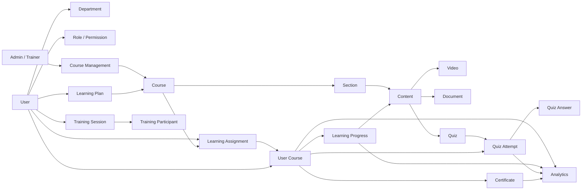
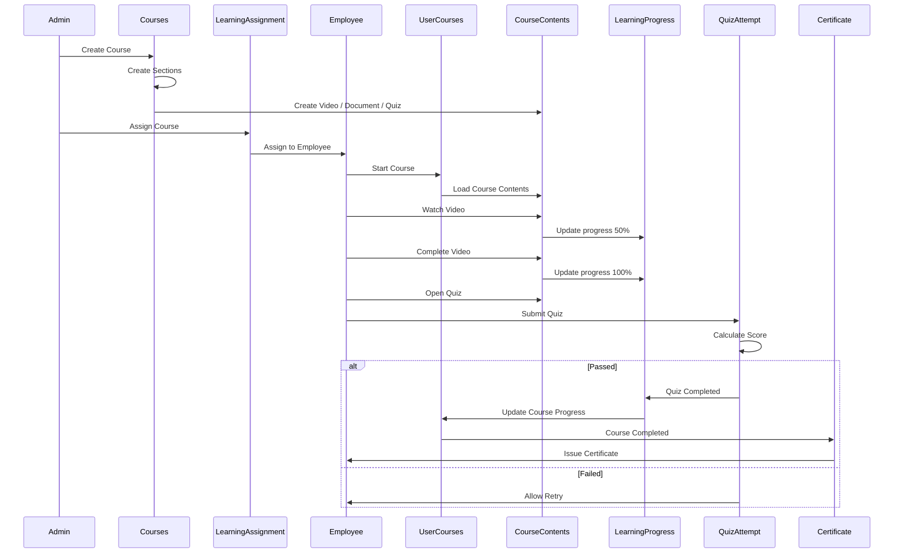

# E-Learning System – Architecture & Learning Flow

## 1. Overview

This document describes the main data relationships and learning workflow of the E-Learning system.

It covers:

* User, Department, Role, and Permission relationships
* Course management
* Course content structure
* Learning assignment and enrollment
* Learning progress tracking
* Quiz and assessment flow
* Certificate issuance
* Learning plans
* Training sessions
* Analytics

---

## 2. System Relationship Overview



### Main Relationships

| Area               | Relationship                                   |
| ------------------ | ---------------------------------------------- |
| Organization       | User → Department                              |
| Authorization      | User → Role / Permission                       |
| Course Management  | Admin / Trainer → Course                       |
| Course Structure   | Course → Section → Content                     |
| Content Types      | Content → Video / Document / Quiz              |
| Assignment         | User + Course → Learning Assignment            |
| Enrollment         | Learning Assignment → User Course              |
| Progress           | User Course → Learning Progress                |
| Assessment         | Quiz → Quiz Attempt → Quiz Answer              |
| Completion         | User Course → Certificate                      |
| Planning           | User → Learning Plan → Course                  |
| Classroom Training | User → Training Session → Training Participant |
| Analytics          | Progress / Quiz / Certificate → Analytics      |

---

## 3. Learning Process Flow



---

## 4. End-to-End Learning Flow

The expected learning lifecycle is:

```text
Admin / Trainer
      │
      ▼
Create Course
      │
      ▼
Create Sections
      │
      ▼
Create Course Contents
(Video / Document / Quiz)
      │
      ▼
Assign Course to Employee
      │
      ▼
Create User Course
      │
      ▼
Employee Starts Course
      │
      ▼
Consume Course Contents
      │
      ├── Video
      │     └── Update Progress
      │
      ├── Document
      │     └── Update Progress
      │
      └── Quiz
            │
            ▼
       Submit Attempt
            │
            ▼
       Calculate Score
         /        \
     Passed      Failed
       │            │
       ▼            ▼
Update Progress   Retry Quiz
       │
       ▼
Course Completed
       │
       ▼
Issue Certificate
       │
       ▼
Update Analytics
```

---

## 5. Core Data Flow

### Course Creation

`Admin / Trainer → Course → Section → Content`

A course contains multiple sections, and each section contains multiple learning contents such as videos, documents, and quizzes.

### Course Assignment

`Admin → Learning Assignment → User → User Course`

The assignment defines which employee needs to take which course. A `User Course` represents the employee's actual enrollment/learning instance.

### Learning Progress

`User Course → Learning Progress → Course Content`

Progress should be tracked at the content level so the system can determine:

* Which contents have been completed
* Current progress percentage
* Last accessed content
* Completion date
* Overall course progress

### Quiz

`Course Content (Quiz) → Quiz Attempt → Quiz Answer`

A user may have multiple quiz attempts depending on the retry policy.

### Certificate

`User Course → Certificate`

A certificate is issued when the required course completion conditions are satisfied.

### Analytics

Analytics can aggregate information from:

* User Course
* Learning Progress
* Quiz Attempt
* Certificate

This allows the system to provide learning dashboards and reports.

---

## 6. Recommended Implementation Order

The system should generally be implemented in this order:

1. Authentication and Authorization
2. Organization / Department / User
3. Course Management
4. Course Content Management
5. Learning Assignment
6. User Course / Enrollment
7. Learning Progress
8. Quiz / Assessment
9. Certificate
10. Learning Plan
11. Training Session
12. Analytics / Reporting

This order follows the primary dependency chain of the learning process and reduces the need to implement dependent modules before their underlying data structures exist.
