# E-Learning System – Database Design

## 1. Overview

This document defines the core database schema for the E-Learning system.

The database is organized into the following functional domains:

1. Identity & Organization
2. Course Management
3. Quiz & Assessment
4. Learning Assignment
5. Learning Plan
6. User Learning & Progress
7. Certificate
8. Offline Training
9. Audit & Analytics

---

## 2. Entity Relationship Diagram

```mermaid
erDiagram

    %% =========================
    %% IDENTITY / ORGANIZATION
    %% =========================

    USERS {
        bigint UserId PK
        varchar EmployeeCode
        varchar Username
        varchar FullName
        varchar Email
        bigint DepartmentId FK
        bigint PositionId FK
        bigint ManagerLevel FK
        datetime JoinDate
        bit IsActive
        datetime CreatedAt
        datetime UpdatedAt
    }

    DEPARTMENTS {
        bigint DepartmentId PK
        varchar DepartmentCode
        varchar DepartmentName
        bigint ParentDepartmentId FK
        bigint ManagerId FK
        bit IsActive
    }

    POSITIONS {
        bigint PositionId PK
        varchar PositionCode
        varchar PositionName
    }

    ROLES {
        bigint RoleId PK
        varchar RoleName
    }

    PERMISSIONS {
        bigint PermissionId PK
        varchar PermissionCode
    }

    USER_ROLES {
        bigint UserId FK
        bigint RoleId FK
    }

    ROLE_PERMISSIONS {
        bigint RoleId FK
        bigint PermissionId FK
    }

    %% =========================
    %% COURSE
    %% =========================

    COURSES {
        bigint CourseId PK
        varchar CourseCode
        varchar CourseName
        varchar Description
        bigint CategoryId FK
        varchar CourseType
        varchar Level
        int Duration
        int Version
        varchar Status
        bigint CreatedBy FK
        datetime CreatedAt
        datetime UpdatedAt
    }

    COURSE_CATEGORIES {
        bigint CategoryId PK
        varchar CategoryName
        bigint ParentCategoryId FK
    }

    COURSE_SECTIONS {
        bigint SectionId PK
        bigint CourseId FK
        varchar Title
        varchar Description
        int DisplayOrder
    }

    COURSE_CONTENTS {
        bigint ContentId PK
        bigint SectionId FK
        varchar ContentType
        varchar Title
        int DisplayOrder
        bit IsRequired
        int Duration
    }

    VIDEOS {
        bigint VideoId PK
        bigint ContentId FK
        varchar FilePath
        varchar FileName
        int Duration
        bigint FileSize
        varchar ThumbnailPath
    }

    DOCUMENTS {
        bigint DocumentId PK
        bigint ContentId FK
        varchar FilePath
        varchar FileName
        bigint FileSize
        varchar FileType
        int Version
    }

    %% =========================
    %% QUIZ
    %% =========================

    QUIZZES {
        bigint QuizId PK
        bigint ContentId FK
        decimal PassingScore
        int MaxAttempts
        int TimeLimit
    }

    QUIZ_QUESTIONS {
        bigint QuestionId PK
        bigint QuizId FK
        varchar QuestionText
        varchar QuestionType
        decimal Score
        int DisplayOrder
    }

    QUIZ_OPTIONS {
        bigint OptionId PK
        bigint QuestionId FK
        varchar OptionText
        bit IsCorrect
        int DisplayOrder
    }

    %% =========================
    %% LEARNING ASSIGNMENT
    %% =========================

    LEARNING_ASSIGNMENTS {
        bigint AssignmentId PK
        bigint CourseId FK
        bigint AssignedBy FK
        varchar AssignmentType
        datetime StartDate
        datetime DueDate
        bit IsMandatory
        varchar Status
        datetime CreatedAt
    }

    LEARNING_ASSIGNMENT_USERS {
        bigint AssignmentUserId PK
        bigint AssignmentId FK
        bigint UserId FK
        datetime AssignedAt
        varchar Status
    }

    %% =========================
    %% LEARNING PLAN
    %% =========================

    LEARNING_PLANS {
        bigint LearningPlanId PK
        bigint UserId FK
        varchar Name
        date StartDate
        date EndDate
        varchar Status
        bigint CreatedBy FK
    }

    LEARNING_PLAN_COURSES {
        bigint LearningPlanCourseId PK
        bigint LearningPlanId FK
        bigint CourseId FK
        int DisplayOrder
        date TargetDate
    }

    %% =========================
    %% USER LEARNING
    %% =========================

    USER_COURSES {
        bigint UserCourseId PK
        bigint UserId FK
        bigint CourseId FK
        bigint AssignmentId FK
        varchar Status
        decimal ProgressPercent
        datetime StartedAt
        datetime CompletedAt
        datetime LastAccessedAt
    }

    LEARNING_PROGRESS {
        bigint ProgressId PK
        bigint UserCourseId FK
        bigint ContentId FK
        varchar Status
        decimal ProgressPercent
        datetime StartedAt
        datetime CompletedAt
        int LastPosition
        int TimeSpent
    }

    %% =========================
    %% QUIZ ATTEMPT
    %% =========================

    QUIZ_ATTEMPTS {
        bigint AttemptId PK
        bigint QuizId FK
        bigint UserId FK
        bigint UserCourseId FK
        int AttemptNo
        datetime StartedAt
        datetime CompletedAt
        decimal Score
        bit Passed
    }

    QUIZ_ANSWERS {
        bigint AnswerId PK
        bigint AttemptId FK
        bigint QuestionId FK
        bigint SelectedOptionId FK
        bit IsCorrect
        decimal Score
    }

    %% =========================
    %% CERTIFICATE
    %% =========================

    CERTIFICATES {
        bigint CertificateId PK
        bigint UserCourseId FK
        bigint UserId FK
        bigint CourseId FK
        varchar CertificateNo
        datetime IssuedDate
        datetime ExpiryDate
        varchar FilePath
        varchar Status
    }

    %% =========================
    %% OFFLINE TRAINING
    %% =========================

    TRAINING_LOCATIONS {
        bigint LocationId PK
        varchar LocationName
        varchar Address
        int Capacity
    }

    TRAINING_SESSIONS {
        bigint SessionId PK
        bigint CourseId FK
        bigint TrainerId FK
        bigint LocationId FK
        varchar Title
        datetime StartDateTime
        datetime EndDateTime
        int Capacity
        varchar Status
    }

    TRAINING_PARTICIPANTS {
        bigint SessionId FK
        bigint UserId FK
        varchar RegistrationStatus
        varchar AttendanceStatus
        datetime JoinedAt
    }

    %% =========================
    %% AUDIT / ANALYTICS
    %% =========================

    LEARNING_ACTIVITY_LOGS {
        bigint ActivityId PK
        bigint UserId FK
        bigint CourseId FK
        bigint ContentId FK
        varchar ActivityType
        datetime ActivityTime
        int Duration
    }

    AUDIT_LOGS {
        bigint AuditId PK
        bigint UserId FK
        varchar Action
        varchar EntityName
        bigint EntityId
        datetime CreatedAt
    }

    %% =========================
    %% RELATIONSHIPS
    %% =========================

    DEPARTMENTS ||--o{ USERS : contains
    POSITIONS ||--o{ USERS : has
    USERS ||--o{ USERS : manages

    USERS ||--o{ USER_ROLES : assigned
    ROLES ||--o{ USER_ROLES : contains

    ROLES ||--o{ ROLE_PERMISSIONS : grants
    PERMISSIONS ||--o{ ROLE_PERMISSIONS : defines

    COURSE_CATEGORIES ||--o{ COURSES : categorizes
    COURSES ||--o{ COURSE_SECTIONS : contains
    COURSE_SECTIONS ||--o{ COURSE_CONTENTS : contains

    COURSE_CONTENTS ||--o| VIDEOS : has
    COURSE_CONTENTS ||--o| DOCUMENTS : has
    COURSE_CONTENTS ||--o| QUIZZES : has

    QUIZZES ||--o{ QUIZ_QUESTIONS : contains
    QUIZ_QUESTIONS ||--o{ QUIZ_OPTIONS : has

    COURSES ||--o{ LEARNING_ASSIGNMENTS : assigned
    USERS ||--o{ LEARNING_ASSIGNMENTS : creates
    LEARNING_ASSIGNMENTS ||--o{ LEARNING_ASSIGNMENT_USERS : targets
    USERS ||--o{ LEARNING_ASSIGNMENT_USERS : receives

    USERS ||--o{ LEARNING_PLANS : owns
    LEARNING_PLANS ||--o{ LEARNING_PLAN_COURSES : contains
    COURSES ||--o{ LEARNING_PLAN_COURSES : included

    USERS ||--o{ USER_COURSES : learns
    COURSES ||--o{ USER_COURSES : learned_by
    LEARNING_ASSIGNMENTS ||--o{ USER_COURSES : creates

    USER_COURSES ||--o{ LEARNING_PROGRESS : tracks
    COURSE_CONTENTS ||--o{ LEARNING_PROGRESS : tracks

    QUIZZES ||--o{ QUIZ_ATTEMPTS : attempted
    USERS ||--o{ QUIZ_ATTEMPTS : makes
    USER_COURSES ||--o{ QUIZ_ATTEMPTS : belongs_to

    QUIZ_ATTEMPTS ||--o{ QUIZ_ANSWERS : contains
    QUIZ_QUESTIONS ||--o{ QUIZ_ANSWERS : answers
    QUIZ_OPTIONS ||--o{ QUIZ_ANSWERS : selected

    USER_COURSES ||--o| CERTIFICATES : earns
    USERS ||--o{ CERTIFICATES : receives
    COURSES ||--o{ CERTIFICATES : certifies

    COURSES ||--o{ TRAINING_SESSIONS : schedules
    USERS ||--o{ TRAINING_SESSIONS : trains
    TRAINING_LOCATIONS ||--o{ TRAINING_SESSIONS : hosts

    TRAINING_SESSIONS ||--o{ TRAINING_PARTICIPANTS : has
    USERS ||--o{ TRAINING_PARTICIPANTS : attends

    USERS ||--o{ LEARNING_ACTIVITY_LOGS : generates
    COURSES ||--o{ LEARNING_ACTIVITY_LOGS : related
    COURSE_CONTENTS ||--o{ LEARNING_ACTIVITY_LOGS : related

    USERS ||--o{ AUDIT_LOGS : performs
```



---

## 3. Database Domain Structure

### 3.1 Identity & Organization

**Main tables:**

* `USERS`
* `DEPARTMENTS`
* `POSITIONS`
* `ROLES`
* `PERMISSIONS`
* `USER_ROLES`
* `ROLE_PERMISSIONS`

This domain handles:

* Employee information
* Department hierarchy
* Job positions
* User roles
* System permissions
* Role-based access control

Relationship:

```text
Department
    │
    └── Users
          │
          ├── Position
          │
          └── Roles
                │
                └── Permissions
```

---

## 4. Course Management

The course structure follows:

```text
COURSE
  │
  ├── SECTION
  │     │
  │     └── CONTENT
  │           ├── VIDEO
  │           ├── DOCUMENT
  │           └── QUIZ
  │                 ├── QUESTION
  │                 │     └── OPTION
```

This structure allows a course to contain multiple sections and each section to contain different types of learning materials.

---

## 5. Learning Assignment

Assignment is separated into two tables:

```text
LEARNING_ASSIGNMENTS
        │
        └── LEARNING_ASSIGNMENT_USERS
                    │
                    └── USERS
```

`LEARNING_ASSIGNMENTS` defines the course assignment itself.

`LEARNING_ASSIGNMENT_USERS` defines which employees receive that assignment.

This supports assigning the same course to multiple employees.

Example:

```text
Assignment #1001
Course: Safety Training
Assigned By: HR Manager
Due Date: 2026-09-30

        │
        ├── Employee A
        ├── Employee B
        ├── Employee C
        └── Employee D
```

---

## 6. User Learning

The actual employee learning instance is stored in `USER_COURSES`.

```text
USER
 │
 └── USER_COURSES
          │
          ├── COURSE
          │
          └── LEARNING_PROGRESS
                    │
                    └── COURSE_CONTENT
```

`USER_COURSES` represents the employee's enrollment and overall course status.

`LEARNING_PROGRESS` tracks progress for individual course contents.

For example:

```text
User: John

Course: Safety Training
Progress: 65%

    Video 1 → Completed
    Video 2 → Completed
    Document 1 → Completed
    Quiz 1 → In Progress
    Video 3 → Not Started
```

---

## 7. Quiz & Assessment

Quiz data follows:

```text
QUIZ
 │
 └── QUESTIONS
       │
       └── OPTIONS

USER
 │
 └── QUIZ_ATTEMPTS
       │
       └── QUIZ_ANSWERS
```

This separates the quiz definition from the user's actual attempts.

A user can therefore have multiple attempts:

```text
Quiz #10

Attempt 1 → 65% → Failed
Attempt 2 → 72% → Failed
Attempt 3 → 85% → Passed
```

---

## 8. Certificate

Certificates are linked to the user's completed course:

```text
USER
 │
 └── USER_COURSES
        │
        └── CERTIFICATES
```

A certificate contains:

* Certificate number
* User
* Course
* Issue date
* Expiry date
* Certificate file
* Certificate status

---

## 9. Offline Training

Offline/classroom training is modeled separately from online learning:

```text
COURSE
   │
   └── TRAINING_SESSION
          │
          ├── TRAINING_LOCATION
          │
          ├── TRAINER
          │
          └── TRAINING_PARTICIPANTS
                    │
                    └── USERS
```

This allows the same course to support both:

* Online learning
* Instructor-led/classroom training

---

## 10. Audit & Analytics

### Learning Activity

`LEARNING_ACTIVITY_LOGS` records user learning activities such as:

```text
Video Started
Video Paused
Video Completed
Document Opened
Quiz Started
Quiz Completed
```

These records can be used for learning analytics.

### Audit

`AUDIT_LOGS` records system operations such as:

```text
Create Course
Update Course
Delete Course
Assign Course
Update User
Change Role
Issue Certificate
```

This provides traceability for administrative operations.

---

## 11. High-Level Data Flow

```text
                         ┌───────────────┐
                         │     USERS     │
                         └───────┬───────┘
                                 │
             ┌───────────────────┼───────────────────┐
             ▼                   ▼                   ▼
       Organization          Authorization       Learning
       Department/Role       Role/Permission       │
                                                     ▼
                                               USER_COURSES
                                                     │
                       ┌─────────────────────────────┼────────────────────┐
                       ▼                             ▼                    ▼
              LEARNING_PROGRESS                QUIZ_ATTEMPTS        CERTIFICATES
                       │                             │
                       ▼                             ▼
                COURSE_CONTENT                 QUIZ_ANSWERS
                       │
          ┌────────────┼────────────┐
          ▼            ▼            ▼
       VIDEO       DOCUMENT       QUIZ
                                   │
                                   ▼
                              QUESTIONS
                                   │
                                   ▼
                                OPTIONS


COURSE
   │
   ├── SECTIONS
   │      └── CONTENTS
   │
   ├── LEARNING_ASSIGNMENTS
   │      └── ASSIGNMENT_USERS
   │
   ├── LEARNING_PLAN_COURSES
   │
   └── TRAINING_SESSIONS
          └── TRAINING_PARTICIPANTS


LEARNING_ACTIVITY_LOGS ──────┐
                             ├──► ANALYTICS / REPORTING
AUDIT_LOGS ──────────────────┘
```

---

## 12. Core Dependency Chain

The most important dependency chain of the system is:

```text
USERS
  ↓
LEARNING_ASSIGNMENTS
  ↓
USER_COURSES
  ↓
LEARNING_PROGRESS
  ↓
COURSE_CONTENTS
  ↓
QUIZ_ATTEMPTS
  ↓
QUIZ_ANSWERS
  ↓
COURSE COMPLETION
  ↓
CERTIFICATES
```

The course definition exists independently:

```text
COURSE
  ↓
COURSE_SECTIONS
  ↓
COURSE_CONTENTS
  ├── VIDEOS
  ├── DOCUMENTS
  └── QUIZZES
       ├── QUESTIONS
       └── OPTIONS
```

The two flows are connected through `USER_COURSES` and `LEARNING_PROGRESS`.

---

## 13. Recommended Database Implementation Order

For implementation, create the database in dependency order:

### Phase 1 – Foundation

```text
DEPARTMENTS
POSITIONS
USERS
ROLES
PERMISSIONS
USER_ROLES
ROLE_PERMISSIONS
```

### Phase 2 – Course

```text
COURSE_CATEGORIES
COURSES
COURSE_SECTIONS
COURSE_CONTENTS
VIDEOS
DOCUMENTS
QUIZZES
QUIZ_QUESTIONS
QUIZ_OPTIONS
```

### Phase 3 – Assignment

```text
LEARNING_ASSIGNMENTS
LEARNING_ASSIGNMENT_USERS
```

### Phase 4 – Learning

```text
USER_COURSES
LEARNING_PROGRESS
```

### Phase 5 – Assessment

```text
QUIZ_ATTEMPTS
QUIZ_ANSWERS
```

### Phase 6 – Completion

```text
CERTIFICATES
```

### Phase 7 – Additional Learning

```text
LEARNING_PLANS
LEARNING_PLAN_COURSES

TRAINING_LOCATIONS
TRAINING_SESSIONS
TRAINING_PARTICIPANTS
```

### Phase 8 – Tracking

```text
LEARNING_ACTIVITY_LOGS
AUDIT_LOGS
```

This order minimizes foreign-key dependency problems during database creation and follows the actual business flow of the LMS.
